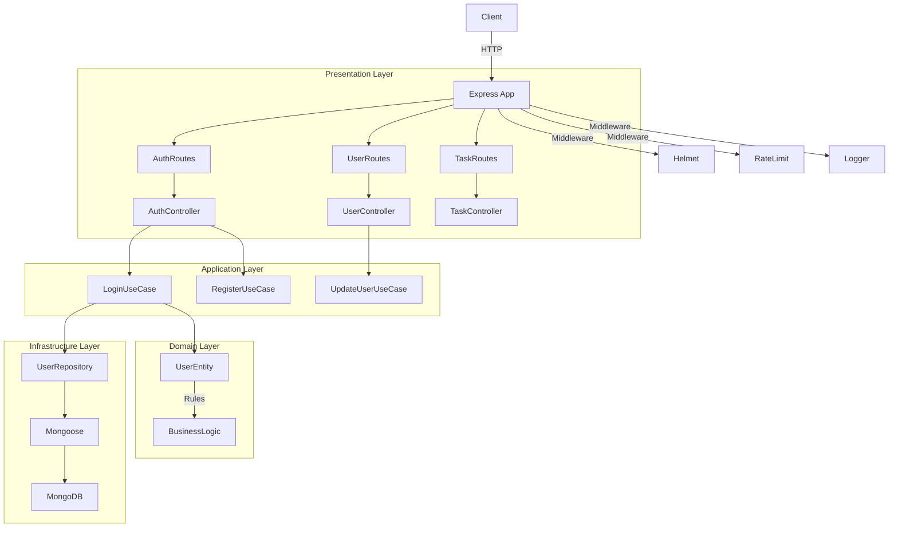

# Arquitetura do Projeto

Este projeto segue os princípios de **Domain-Driven Design (DDD)** e **Clean Architecture**, focando na separação de responsabilidades e independência de frameworks.

## Diagrama de Arquitetura

## Camadas

### 1. Presentation (Interface)

Responsável por interagir com o mundo externo (HTTP, Sockets, CLI).

- **Controllers:** Recebem input, chamam casos de uso e retornam output formatado.
- **Routes:** Mapeiam URLs para controllers.
- **DTOs:** Objetos de transferência de dados (muitas vezes implícitos nos schemas de validação).
- **Middlewares:** Tratamento transversal (Auth, Logging, Error Handling).

### 2. Application (Casos de Uso)

Contém a lógica de aplicação. Orquestra as entidades de domínio e interfaces de infraestrutura.

- **Use Cases:** Ex: `RegisterUserUseCase`, `CreateTaskUseCase`.
- Cada Use Case tem uma única responsabilidade (SRP).

### 3. Domain (Regras de Negócio)

O coração do software. Não depende de nenhuma outra camada externa.

- **Entities:** Ex: `User`, `Task`. Contêm estado e comportamento.
- **Interfaces:** Contratos para repositórios e serviços (ex: `IUserRepository`).
- **Domain Errors:** Erros específicos de negócio.

### 4. Infrastructure (Implementação)

Implementações concretas das interfaces definidas no Domínio.

- **Repositories:** Implementação com Mongoose/MongoDB.
- **Services:** Implementação de serviços externos (Email, Storage).
- **Logger:** Winston.
- **Database:** Conexão MongoDB.

## Padrões Adotados

- **Dependency Injection:** Container manual em `src/shared/container`.
- **Repository Pattern:** Abstração de acesso a dados.
- **Result Pattern (via Exceptions):** Uso de exceptions customizadas para fluxo de erros.
- **Value Objects:** (Futuro) Para encapsular validações de campos específicos.
